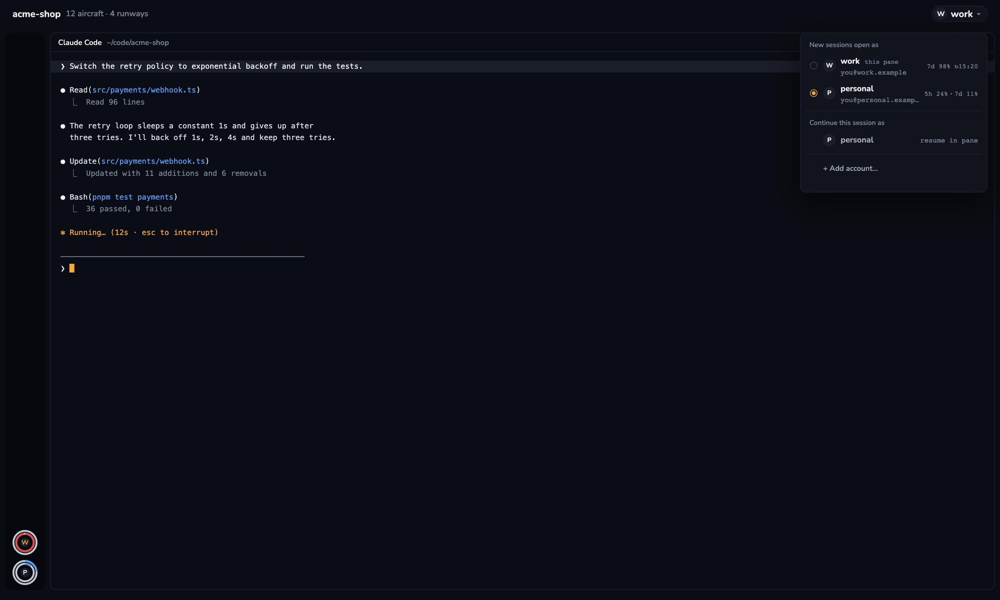

# Claude Accounts

A [Herdr](https://herdr.dev) mod for running Claude Code as more than one account. Each account's 5h and 7d usage sits in the window's head, and a small chip there names the account the focused Claude Code agent runs under; clicking it lists every account with its signed-in email and recorded usage, makes one the account new sessions start under, resumes the current session as another account in a pane beside it, or makes a new one. The same work is available as `cca`, a shell command you can use over SSH from a phone.

It is meant for switching between distinct accounts such as work and a side project; each provider's terms apply to how you use them.



An account is one Claude Code config dir. `default` is `~/.claude` (run with `CLAUDE_CONFIG_DIR` unset); every `~/.claude-accounts/<name>/` is another, with its own login. Settings, skills, hooks and session history are shared through symlinks, so `claude -c` and `claude --resume` see the same conversations in every account.

## Add it

Paste this into an agent running in Herdr:

```
Read ~/.config/herdr-app/AGENTS.md, then add this mod: https://github.com/lcalmsky/herdr-claude-accounts
```

The mod is `none`-placed, so it does nothing until a layout places the chip or you press its key. Copy `mods/claude-accounts/` to `~/.config/herdr-app/mods/claude-accounts/`, merge `keys.json` into yours (`ctrl-shift-a`), and put the chip in a head block (150 px is roomy):

```json
{ "id": "accounts", "type": "block", "size": { "px": 150 }, "window_drag": true,
  "content": { "mod": "claude-accounts", "props": { "role": "chip" } } }
```

Or show every account at once with the `rail` role: one 40 px avatar per account, stacked from the bottom of a side rail (a 96 px block fits two accounts; each extra account needs 48 px more):

```json
{ "id": "rail-accounts", "type": "block", "size": { "px": 96 },
  "content": { "mod": "claude-accounts", "props": { "role": "rail" } } }
```

Each avatar is two rings around a letter: the 5h window outside and the 7d window inside, each a full `#c4c8d2` track filled clockwise from 12 o'clock in `#5b9cf5` (`#e5484d` from 90 %); the rings sit in fixed slots, so every avatar has the same outer edge, with the account's first letter on a `#1a1e28` disc in the middle — amber `#f2a93b` and moved to the top for the account of the focused Claude Code pane, otherwise bright `#eef0f5` on the account new sessions open as and dim `#7a8296` on the others. The tooltip carries the label, both percentages and, from 90 %, the reset time; clicking opens the same popup as the chip. It sits at the bottom of a narrow column, 64 px wide for example.

With no chip in the layout, `ctrl-shift-a` still opens the accounts popup.

The CLI is the same folder's `cca`:

```sh
ln -s ~/.config/herdr-app/mods/claude-accounts/cca ~/.local/bin/cca
```

### Reading accounts

```sh
cca                      # or: cca ls
cca ls --json            # the same list as one line of JSON, for tidemark
cca work -c              # continue this folder's latest conversation as work
cca home --resume <id>   # resume a particular session as home
cca use work             # start every new session under work
cca current              # which account that is
cca add staging          # create ~/.claude-accounts/staging, then cca staging to log in
cca share staging        # link the shared history into an account made before sharing existed
cca share --dry-run old  # what share would do, without changing anything
```

`cca ls` prints a marker on the account of the current shell, the name (or `label (name)` when the account has a label), email, 5h and 7d usage (`↻HH:MM` is the reset time once a window is nearly spent), and the account with the most 5h headroom. It fits about 60 columns and colours only a terminal. `cca ls --json` prints the same list as one line, `{"current":"work","accounts":[{"name":"default","email":"me@example.com","five_hour":{"used":12.0,"resets_at":1793778000},"seven_day":{…},"updated_at":1793777782,"best":true}]}`: percentages and epoch seconds, a window past its reset read as 0 % with its reset time kept, `best` on the most 5h headroom, and `current` the global default below. It needs no terminal and prints valid JSON even with no usage files.

### Default for new sessions

`cca use <name>` makes one account the default for every Claude Code session started afterwards: a new shell's `claude`, a new Herdr tab, and tidemark's switch. It writes one name to `${XDG_STATE_HOME:-$HOME/.local/state}/herdr-tower/current`, and `cca current` prints it (`default` when the file is missing or unreadable or the account was removed). Sessions already running keep the account they started with.

The default reaches a shell through a `claude` function, so add one line at the end of `~/.zshrc`:

```sh
[ -x "$HOME/.local/bin/cca" ] && eval "$("$HOME/.local/bin/cca" shell-init)"
```

`cca shell-init` prints that function for zsh, bash and sh. With `CLAUDE_CONFIG_DIR` and `CCA_ACCOUNT` both unset it reads the file with the shell's builtin `read` — it starts no process on every `claude` — and, if the name is an existing non-default account, runs `claude` with `CLAUDE_CONFIG_DIR="$HOME/.claude-accounts/<name>"`; otherwise it runs the real `claude` unchanged. An explicit choice wins: `cca <name>`, the popup's resume rows and the add form's Create export `CCA_ACCOUNT` (including `default`, where `CLAUDE_CONFIG_DIR` stays unset), so the hook leaves them alone. Herdr starts agents in your interactive shell, so a new tab running `claude` goes through the function.

## Before adding it

The mod runs programs and reads files outside its own folder:

- every 30 s, and when the focused agent changes, it runs `cca --porcelain <pid>` when the focused agent is a local Claude Code process and plain `cca --porcelain` otherwise. That reads the focused Claude process's environment with `ps -E -ww -p <pid> -o command=` for its `CLAUDE_CONFIG_DIR`, reads the global default from `${XDG_STATE_HOME:-$HOME/.local/state}/herdr-tower/current`, reads the signed-in email from `~/.claude.json` and `~/.claude-accounts/*/.claude.json`, reads usage files under `${XDG_STATE_HOME:-$HOME/.local/state}/herdr-tower/usage/`, and reads `$HOME/.claude/sessions/<pid>.json` for the focused session's `sessionId` and `cwd`;
- an account row only makes that account the default for new sessions; **Add account**'s Create and a resume row open `claude` in a pane beside the focused one with `CLAUDE_CONFIG_DIR` set to that account's folder (for `default`, unset) and `CCA_ACCOUNT` set to its name;
- `cca use <name>` writes one name into `${XDG_STATE_HOME:-$HOME/.local/state}/herdr-tower/current`, and the popup's rename writes display labels to `${XDG_STATE_HOME:-$HOME/.local/state}/herdr-tower/labels` (read again by every `cca --porcelain`) — the only things it writes outside the account folders — and `cca shell-init`'s `claude` function reads the current file on every call;
- **Add account** creates `~/.claude-accounts/<name>/` and symlinks everything in `~/.claude` into it except the login and per-process state, so settings, `CLAUDE.md`, skills and hooks are shared. It also creates `projects`, `sessions`, `history.jsonl` and the other shared history entries under `~/.claude` when missing, and links them;
- **share** merges an existing account's real history entries into `~/.claude` (`cp -Rn`; `history.jsonl` appended), moves the account's copy aside to `<entry>.pre-share-<epoch>`, then links it. It never deletes and never overwrites anything in `~/.claude`.

It makes no network calls and never reads `.credentials.json` or the keychain. `cca` is the only shell code: the mod executes it and parses its tab-separated output.

### Usage (optional)

Claude Code hands its rate limits only to the status line command, so the popup can show them only if `usage-tap.sh` runs in front of your status line in `~/.claude/settings.json`:

```json
"statusLine": {
  "type": "command",
  "command": "sh $HOME/.config/herdr-app/mods/claude-accounts/usage-tap.sh node ${CLAUDE_CONFIG_DIR:-$HOME/.claude}/hud/hud-with-peers.mjs"
}
```

Keep your own command after the tap path unchanged. The tap passes the same input through, writes `${XDG_STATE_HOME:-$HOME/.local/state}/herdr-tower/usage/<account>.json` when `node` is available, prints nothing of its own and never breaks the status line.

### Over SSH

`cca` works over SSH, but a macOS login started from SSH has a locked keychain. If `cca <name>` starts Claude Code as not logged in although that account's `.claude.json` names an email, unlock the keychain in that session first:

```sh
security unlock-keychain
```

## License

MIT. The bundled Nunito font is under the SIL Open Font License 1.1 (`mods/claude-accounts/fonts/OFL.txt`). `RECIPE.md` is the brief to build the mod from scratch.
