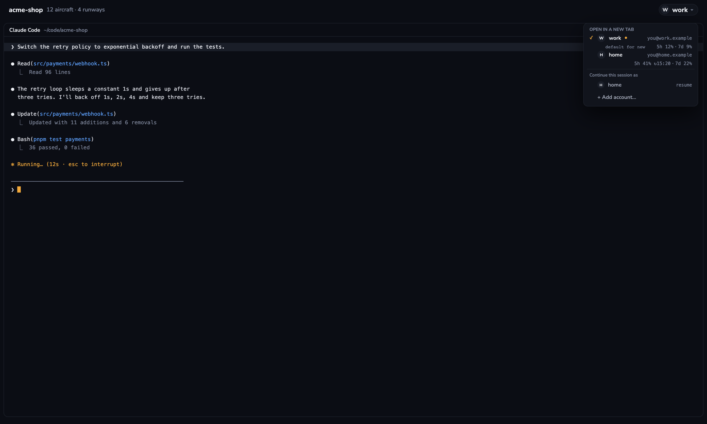

# Claude Accounts

A Herdr mod for running Claude Code as several accounts. A 26 px chip at the right end of the window's head names the account the focused Claude Code agent runs under; clicking it opens a 260 px popup listing every account with its email and 5h/7d usage, with rows to open one in a new tab, resume the current session as another account, or add an account. The same logic is a shell command, `cca`, so an SSH session from a phone can list accounts and start Claude Code under any of them. Everything is an ink-grey console with one amber accent; only a small amber dot marks the account with the most 5h headroom.

## What you see

- **Chip** (26 px tall, radius 13, `#11141c`, 1 px `#1d212b` hairline, hover `#161a24`): 3 px left and 10 px right padding, 6 px gaps, tooltip "Claude accounts". A 20 px round avatar (`#1a1e28`, the account name's first letter, Nunito 11 px bold `#eef0f5`), the account name (Nunito 13 px semibold `#eef0f5`) and "▾" (Nunito 10 px, `#7a8296`). Its block right-aligns it with 20 px on the right; the block is whatever width the layout gives it (150 px in the shipped example), 44 px tall.
- **Popup** (260 px wide, radius 10, `#11141c`, 1 px `#1d212b` frame and shadow; 5 px padding):
  - a 18 px header, "OPEN IN A NEW TAB" (Nunito 10 px bold `#7a8296`), 8 px inset;
  - one 38 px row per account, 8 px side padding, radius 6, hover `#161a24`; vertically centred inside it, a 18 px line and a 18 px line 1 px apart. The first line: a 10 px column with an amber `#f2a93b` "✓" on the chip's account, an 18 px round avatar (`#1a1e28`, first letter, Nunito 9 px bold), the account name (Nunito 12 px semibold `#eef0f5`), a 5 px amber dot when this account has the most 5h headroom (tooltip "Most 5h headroom"), and right-aligned the signed-in email (Geist Mono 10.5 px `#7a8296`, truncated; "not signed in" when none). The second line: on the global default for new sessions, `default for new` 36 px in (Geist Mono 10 px `#7a8296`, under the name so the email keeps its room), and right-aligned `5h 12% · 7d 9%` (Geist Mono 10.5 px `#7a8296`; the 5h percentage turns `#e5484d` at 100 %; a window used 90 % or more adds ` ↻HH:MM`; "no usage yet" when the account has no usage file);
  - a 1 px `#1d212b` divider, 4 px above and below, 2 px inset;
  - when the focused agent is a local Claude Code process with a session file, a 18 px "Continue this session as" header (Nunito 10 px semibold `#7a8296`) and one 26 px row per other account: a 10 px spacer, a 16 px avatar, the name (Nunito 12 px semibold `#a3a9b8`), and "resume" at the right (Geist Mono 10 px `#7a8296`); hover `#161a24`;
  - a 30 px "+ Add account…" row (10 px spacer, Nunito 12 px semibold `#a3a9b8`), hover `#161a24`.
- **Add account popup** (260 × 170, 14 px padding, 8 px gaps): "Add account" (Nunito 14 px bold `#eef0f5`), "Creates ~/.claude-accounts/<name>" (Nunito 11 px `#7a8296`), a 32 px input (`#1a1e28`, 1 px `#1d212b`, Nunito 13 px), an error line in `#e5484d` when there is one, and two 30 px buttons at the right: Cancel (`#1a1e28` with a `#1d212b` border) and "Create" (`#f2a93b` with dark `#0b0d14` text).
- **The shell** (`cca`) is text only: a marker `*`, the name, email, 5h and 7d cells, and "Most 5h headroom: <name>", about 60 columns. It colours only when stdout is a terminal and `NO_COLOR` is unset.

## How it behaves

- **Reading accounts**: on start, every 30 s and whenever the focused agent's pid changes, the mod runs `cca --porcelain <pid>` (no pid when no local Claude Code agent is focused) and parses its tab-separated lines: `C` the account of that process (from the last `CLAUDE_CONFIG_DIR=` token in `ps -E -ww -p <pid> -o command=`; no token or `$HOME/.claude` is `default`, `$HOME/.claude-accounts/<name>` is `<name>`), `D` the global default for new sessions from `${XDG_STATE_HOME:-$HOME/.local/state}/herdr-tower/current` (`default` when absent or unusable), `A` an account and its email from `~/.claude.json` / `<dir>/.claude.json` (`oauthAccount.emailAddress`, else "not signed in"), `U` the five_hour and seven_day used percentage and reset epoch from `${XDG_STATE_HOME:-$HOME/.local/state}/herdr-tower/usage/<account>.json`, and `S` the focused pid's session id and cwd from `$HOME/.claude/sessions/<pid>.json`. A failed read keeps the last table; a `cca` that cannot be run (exit 127 or a rejected `exec`) shows `?` on the chip with tooltip `cca not found: <path>` and a one-line error row in the popup instead of the table.
- **Spent windows**: a window whose reset epoch is in the past counts as 0 % and has no reset time. The reset time is shown only once a window is at 90 % or more.
- **Most 5h headroom**: the lowest live 5h percentage among accounts with a five-hour window; the popup marks that row with the 5 px amber dot, `cca ls` names it.
- **Clicking the chip**: opens the accounts popup above the layout, sized 67 + 38 px per account, plus 18 + 26 px per resume row when a session is known, and hands it the chip's own table so the popup renders filled at once.
- **Clicking an account row**: closes the popup and runs `tab.new {name, argv: ["sh","-lc","<env> exec claude"]}` in the focused space, where `<env>` is `unset CLAUDE_CONFIG_DIR; CCA_ACCOUNT=default` for `default` and `CLAUDE_CONFIG_DIR="$HOME/.claude-accounts/<name>"; CCA_ACCOUNT=<name>` otherwise. (The default account must run with the variable unset: set to `~/.claude`, Claude Code reads `~/.claude/.claude.json` rather than `~/.claude.json` and starts empty. `CCA_ACCOUNT` makes the click win over the shell hook's global default.) Running agents keep their own account.
- **Clicking a resume row**: closes the popup and runs `tab.new {name, folder: cwd, argv: ["sh","-lc","<env> exec claude --resume <sessionId>"]}` with the same `<env>` after the id passes a UUID test, so the old tab keeps running.
- **Clicking "+ Add account…"**: opens the add form. Create rejects anything but `A-Z a-z 0-9 _ -`, the reserved `default`, the command names `ls`, `add`, `share` and `help`, and any name starting with `-` (`<name> is a cca command.`); on success it closes both popups and opens the new account the same way, ready for `claude`'s login. An invalid or existing name stays in the form with the reason (exit codes 2, 3, 4, 5 from `cca --porcelain-add`).
- **`cca`**:
  - `cca` / `cca ls` lists `default` first, then every `~/.claude-accounts/*` whose name is valid, marks the current shell's account (from its own `CLAUDE_CONFIG_DIR`), and prints "Most 5h headroom: <name>" (or `–`).
  - `cca <name> [args…]` validates the name, requires the account folder, sets or unsets `CLAUDE_CONFIG_DIR`, exports `CCA_ACCOUNT=<name>` so the choice outranks the shell hook, and `exec`s `claude` with the remaining arguments, so `cca work -c` continues the latest conversation in the current folder as `work`.
  - `cca use <name>` makes `<name>` the global default for every session started afterwards, writing the name as one line to `${XDG_STATE_HOME:-$HOME/.local/state}/herdr-tower/current` through a temp file and `mv`. Exit 0 on success, 2 for a bad or reserved name, 3 when `~/.claude-accounts/<name>` does not exist (`default` always does). `cca current` prints that default, or `default` when the file is missing, invalid, or names a since-deleted account. Running sessions are never changed.
  - `cca shell-init` prints a `claude()` function for zsh, bash and sh. With `CLAUDE_CONFIG_DIR` and `CCA_ACCOUNT` both unset it reads the choice file with the shell's builtin `read` (no process is started) and runs the real `claude` with `CLAUDE_CONFIG_DIR="$HOME/.claude-accounts/<name>"` when the name is an existing non-default account, otherwise unchanged. `cca <name>` and the mod's rows export `CCA_ACCOUNT`, so an explicit choice wins over the default.
  - `cca ls --json` prints one line of JSON for tidemark: `{"current":"<name>","accounts":[{"name","email","five_hour":{"used","resets_at"},"seven_day","updated_at","best"}]}`. `used` is a percentage and periods are epoch seconds; a window past its reset reads `used` 0 with `resets_at` kept; `email` is `null` when not signed in; `updated_at` is `null` without a usage file; `best` is the most 5h headroom, by the table's first-lowest rule; `current` is the global default. It escapes strings, needs no terminal, and prints valid JSON with no accounts or usage files.
  - `cca add <name>` makes the folder and links everything in `~/.claude` into it except `.credentials.json`, `.claude.json`, `shell-snapshots`, `statsig`, `ide`, `debug`, `backups`, `telemetry`, `cache`, `transcripts`, `jobs`, `logs`, `daemon*`, `.session-stats.json`, `.last-*` and `*.lock`. It first creates the shared history entries under `~/.claude` (`projects`, `file-history`, `todos`, `plans`, `tasks`, `teams`, `paste-cache`, `session-env`, `sessions`, and `history.jsonl` as a file) so Claude Code cannot keep a private copy. Any failure removes the half-made folder.
  - `cca share [--dry-run] <name>` walks the same shared entries in an account made before sharing existed. A real directory is merged into `~/.claude` with `cp -Rn` (never overwriting), `history.jsonl` is appended, the account's original is moved to `<entry>.pre-share-<epoch>`, and the entry is replaced by a symlink to `~/.claude`. An entry absent in the account is simply linked; an existing symlink to `~/.claude/<entry>` is reported as already shared and skipped, while a link anywhere else is an error (`<entry> links elsewhere: <target>`) and is left alone. Before a merge or append, `share` checks that `<entry>.pre-share-<epoch>` is free, so a failure cannot leave a second copy of `history.jsonl` behind on a rerun. `--dry-run` prints the plan and changes nothing.
  - `cca help` prints the commands; `cca --porcelain [pid]` and `cca --porcelain-add <name>` are the mod's machine output.
  - Names are validated with `^[A-Za-z0-9_-]+$` before anything uses them; `ls`, `add`, `share`, `use`, `current`, `shell-init`, `help` and names starting with `-` are refused as cca commands, and `default` is `~/.claude`.
- **`ctrl-shift-a`** runs `mod.open:claude-accounts`, which opens the same popup from `mod.json` (260 × 300) without a chip in the layout. `mod.open` again closes it; Esc closes it too.

## Built from

- `mods/claude-accounts/main.js`, a `View` with `props().role`:
  - `"chip"`: the chip; clicking it calls `openOverlay({mod: "claude-accounts", kind: "popup", width: 260, height: 67 + 38 × accounts + 18 + 26 × resumeRows, props: {role: "menu", current, globalDefault, accounts, session, error}})` so the popup's first frame is already filled.
  - no role or `"menu"`: the accounts popup (the copy `mod.open` makes). It starts from `props()` when the chip passed them and always reads `cca` itself with the focused pid, inside a vertical scroll; it closes with `closeOverlay(props().overlay)`.
  - `props().mode === "add"`: the add form. Its Create runs `cca --porcelain-add <name>` through `exec`.
  - `herdr` functions: `agents`, `terminals`, `focused`, `run`, `exec`, `props`, `appHome`, `openOverlay`, `closeOverlay`. Commands: `tab.new`. `gpui-base`: `InputState`, `Input`.
- `mods/claude-accounts/mod.json`: `{"place":"none","title":"Claude accounts","overlay":{"kind":"popup","width":260,"height":300}}`.
- `mods/claude-accounts/cca`: POSIX `sh`, executable, the only implementation of the shell logic. It uses `ps -E`, `grep`, `sed`, `tr`, `awk` (headroom comparison), `date`, `cp -Rn`, `mkdir`, `mv` and `ln -s`, and touches only `$HOME/.claude`, `$HOME/.claude.json`, `$HOME/.claude-accounts` and `${XDG_STATE_HOME:-$HOME/.local/state}/herdr-tower/` (usage files and the `current` default). No network, no `.credentials.json`, no keychain.
- `mods/claude-accounts/usage-tap.sh`: the optional status-line tap, moved unchanged from the control-tower layout. It copies stdin to a temp file, writes the rate limits with `node -e` when `node` exists, and `exec`s the original command with the same stdin.
- `keys.json`: `{"global": {"ctrl-shift-a": "mod.open:claude-accounts"}}`.
- A layout places the chip as `{"id": "accounts", "type": "block", "size": {"px": 150}, "window_drag": true, "content": {"mod": "claude-accounts", "props": {"role": "chip"}}}`.
- `mods/claude-accounts/fonts/`: Nunito SemiBold and Bold (OFL), loaded by Herdr for `font_family("Nunito")`; `Geist Mono` names the mono face Herdr ships.
- `art/preview.html` is a sample-data rebuild (accounts `work` and `home`) and `art/render.mjs` screenshots it with Chrome, `playwright-core` and a 1.5× device scale, giving 2400 × 1440 `preview.png`.
- Colors: card `#11141c`, raised `#1a1e28`, selected `#161a24`, line `#1d212b`, text `#eef0f5`, secondary `#a3a9b8`, dim `#7a8296`, amber `#f2a93b`, error `#e5484d`.

## Watch out

- Herdr has no API for a mod's own folder. The mod calls `appHome()` and runs `sh <appHome>/mods/claude-accounts/cca`, so the folder must be named `claude-accounts` under the Herdr home (`HERDR_APP_HOME` or `~/.config/herdr-app`): the path is built from that name. `herdr-app check` on the repo copy still uses the installed `cca`. A mod cloned with `mod.clone` would look for its own name and find no `cca`.
- All account shell work lives in `cca`. Do not grow a second copy of it in `main.js`; the mod only parses `--porcelain`.
- The chip computes the popup height from its own table. The copy opened by `ctrl-shift-a` takes the fixed 300 px in `mod.json`, so the menu scrolls vertically inside whatever height it gets.
- Reading accounts is Claude Code only: a focused non-Claude agent leaves the chip on `default`.
- The usage files keep the old `herdr-tower` state folder name on purpose: existing status lines already write there.
- `↻` is three bytes in UTF-8 but one column, and so is `–`. `cca` never measures a padded cell with `${#}` or printf's width: it pads the ASCII part to its own known length and counts `↻HH:MM` and `–` as the columns they take, so the table aligns under both `LC_ALL=C` and UTF-8.
- Account names are restricted to `A-Z a-z 0-9 _ -`, and `default`, `ls`, `add`, `share`, `help` and names starting with `-` are reserved. An account folder that exists but does not match is hidden from both the popup and `cca ls`.
- `cp -n` on BSD (macOS) exits 1 when it merely skips an existing file; `share` treats an empty stderr as success instead of trusting its status.
- `share` refuses to overwrite an aside with the same epoch; running it twice is safe because the second run sees symlinks.
- The chip's block width is fixed by the layout; a very long account name is not truncated by the chip itself (the head clips).
- The window head the chip sits in is the layout's: this mod draws no background.

## Done when

- `herdr-app check mods/claude-accounts` passes, and `herdr-app status` shows no errors from it.
- With the chip in a layout, it names the account of the focused Claude Code agent; focusing an agent under another `CLAUDE_CONFIG_DIR` changes the name within 30 s.
- Clicking the chip lists `default` and each `~/.claude-accounts/*` with its email, a "✓" on the chip's account and an amber dot on the account with the most 5h headroom; choosing one opens `claude` in a new tab under that account.
- With a local Claude Code agent focused and another account present, "Continue this session as" resumes that `sessionId` under the other account in a new tab at the same cwd, leaving the old tab running.
- "+ Add account…" creates `~/.claude-accounts/<name>` with the shared entries linked into `~/.claude` and opens the login tab; a bad or existing name stays in the form with the reason.
- `ctrl-shift-a` opens the same popup in a layout without the chip.
- `cca ls` prints the table without exceeding 60 columns, marks the shell's account with `*`, and names the most-5h-headroom account; `NO_COLOR=1 cca ls` and a pipe both print no escape codes.
- `cca work -c` starts Claude Code with `CLAUDE_CONFIG_DIR=~/.claude-accounts/work`; `cca default` starts it with the variable unset.
- `cca add` then `cca share --dry-run` on a fresh account print a plan, and `cca share` leaves `~/.claude` unchanged where it already had files, with the account's originals at `<entry>.pre-share-<epoch>`.
- `cca use work` prints `work`, `cca current` prints it, and a shell opened afterwards with the shell hook installed starts `claude` under `~/.claude-accounts/work`; `cca use nope` exits 3 and `cca use ls` exits 2. Sessions already running are unchanged.
- In that same new shell, `CCA_ACCOUNT=default claude` and `cca default` start with `CLAUDE_CONFIG_DIR` unset and `CLAUDE_CONFIG_DIR=/elsewhere claude` keeps its own dir.
